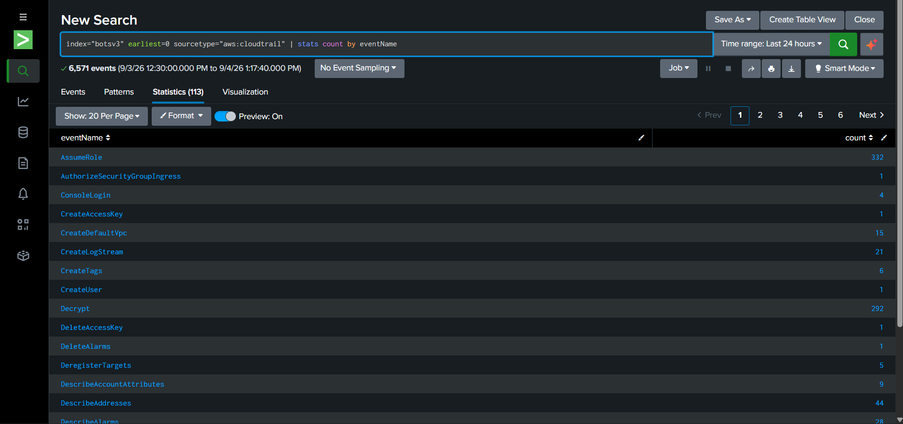
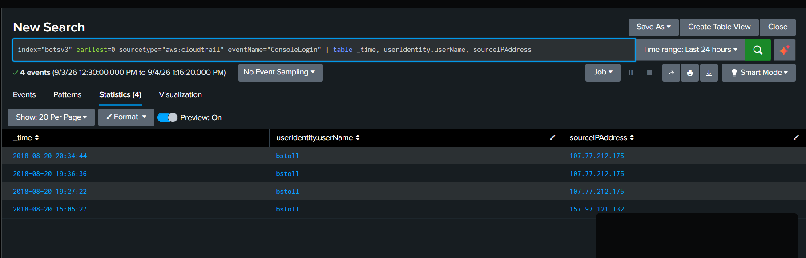
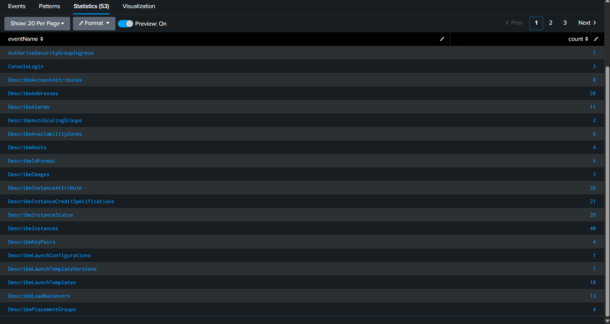
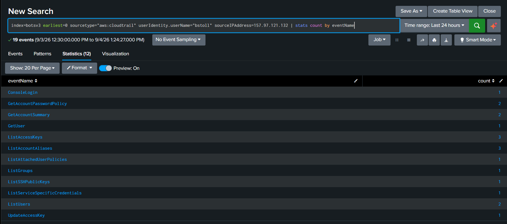
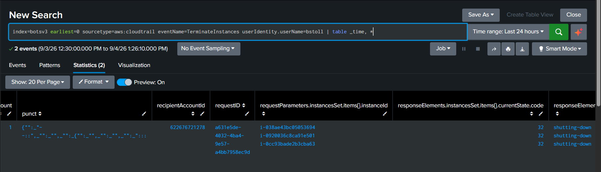
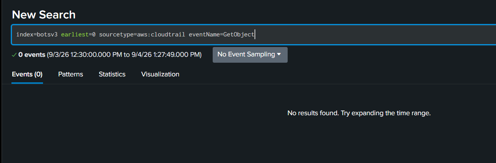

<div align="center">

# 🛡️ Splunk BOTS v3 Incident Investigation

### AWS Cloud Attack Investigation | Splunk | BOTS v3

**Detecting, Investigating, and Analyzing AWS Cloud Security Threats Using Splunk SIEM**

<br>


<br>

**Author: Akash Reddy Gaddam**

Cybersecurity | Blue Team | SOC Operations | Threat Detection

</div>

---

## 📌 Project Overview

This project focuses on investigating a simulated AWS cloud security attack using **Splunk Enterprise** and the publicly available **Boss of the SOC (BOTS) v3 dataset**.

The investigation analyzes AWS CloudTrail activity to identify suspicious authentication behavior, compromised account usage, cloud resource enumeration, unauthorized infrastructure changes, and destructive activities.

The objective is to demonstrate practical Security Operations Center (SOC) investigation skills, SIEM-based threat detection, incident analysis, and MITRE ATT&CK mapping.

## 🎯 Project Objectives

- Investigate suspicious AWS authentication activities.
- Identify potential compromised IAM credentials.
- Analyze AWS CloudTrail logs using Splunk SPL.
- Detect suspicious API calls and cloud resource enumeration.
- Investigate unauthorized EC2 instance termination.
- Evaluate potential data exposure and exfiltration.
- Map attacker behavior to MITRE ATT&CK techniques.
- Document findings and recommend security improvements.

## 🛠️ Tools & Technologies

| Technology | Purpose |
|---|---|
| Splunk Enterprise | SIEM log ingestion and investigation |
| AWS CloudTrail | AWS activity and API event analysis |
| BOTS v3 Dataset | Simulated security attack dataset |
| Python | Supporting security log analysis |
| SPL | Threat detection and event correlation |
| MITRE ATT&CK | Adversary behavior classification |

## 🔍 Investigation Workflow

The investigation followed these major stages:

1. **Log Analysis** – Reviewed AWS CloudTrail events.
2. **Authentication Investigation** – Identified suspicious console login activity.
3. **User Behavior Analysis** – Compared IAM user activity across geographic locations.
4. **Threat Detection** – Investigated unusual API activity and resource enumeration.
5. **Impact Analysis** – Identified destructive EC2 activities.
6. **Exfiltration Assessment** – Checked available S3 object-access events.
7. **MITRE Mapping** – Classified observed attacker behavior.
8. **Recommendations** – Identified security improvements and mitigation strategies.

## 🚨 Key Investigation Findings

### 1. Suspicious Authentication Activity

Identified four successful AWS ConsoleLogin events associated with a single IAM user (`bstoll`) originating from two different geographic locations:

- New Jersey
- California

The activity suggested potential credential compromise.

### 2. AWS Resource Enumeration

Observed unusual automated API activity from the California source, including:

- 40+ DescribeInstances requests.
- 55 GetBucketAcl requests.
- 33 DescribeVolumes requests.

These activities indicated systematic cloud infrastructure and storage discovery.

### 3. Security Group Modifications

Identified security group rule modification activity involving:

- AuthorizeSecurityGroupIngress
- RevokeSecurityGroupIngress

These events warranted investigation for potential unauthorized network configuration changes.

### 4. EC2 Instance Termination

Identified three terminated EC2 instances:

- `i-038ae43bc05053694`
- `i-0920036c8ca91e501`
- `i-0cc93bade2b3cba63`

These actions represented a significant availability impact.

### 5. Data Exfiltration Assessment

Investigated S3 GetObject events.

No GetObject events were found in the analyzed dataset. However, the absence of logged object-access events does not independently prove that data was not exfiltrated, particularly where S3 data-event logging may be incomplete.

## 📊 Investigation Screenshots

### AWS Event Analysis



### Console Login Investigation



### California Source Activity



### New Jersey Source Activity



### EC2 Instance Termination



### S3 Data Exfiltration Assessment



## 🔎 Splunk Detection Queries

### 1. Identify AWS Console Login Activity

```spl
index=botsv3 sourcetype=aws:cloudtrail eventName=ConsoleLogin
| table _time, userIdentity.userName, sourceIPAddress
```

### 2. Investigate User API Activity

```spl
index=botsv3 sourcetype=aws:cloudtrail userIdentity.userName=bstoll
| stats count by eventName, sourceIPAddress
| sort - count
```

### 3. Detect EC2 Instance Termination

```spl
index=botsv3 sourcetype=aws:cloudtrail eventName=TerminateInstances
| table _time, userIdentity.userName, sourceIPAddress, *
```

### 4. Investigate S3 Object Access

```spl
index=botsv3 sourcetype=aws:cloudtrail eventName=GetObject
| stats count by userIdentity.userName
```

## 🎯 MITRE ATT&CK Mapping

| Observed Activity | Technique ID | Technique |
|---|---|---|
| Abuse of valid IAM credentials | T1078 | Valid Accounts |
| AWS infrastructure enumeration | T1580 | Cloud Infrastructure Discovery |
| S3 bucket discovery | T1619 | Cloud Storage Object Discovery |
| Security group modification | T1562.007 | Impair Defenses: Disable or Modify Cloud Firewall |
| EC2 instance termination | T1485 | Data Destruction |

## ⚠️ Impact Assessment

| Security Area | Impact | Assessment |
|---|---|---|
| Confidentiality | Low–Moderate | No confirmed object-level data access in available logs |
| Integrity | Moderate | Security group configuration changes identified |
| Availability | High | Three EC2 instances terminated |

## 🛡️ Security Recommendations

1. Rotate potentially compromised IAM credentials.
2. Enforce Multi-Factor Authentication (MFA).
3. Implement least-privilege IAM policies.
4. Enable AWS GuardDuty for threat detection.
5. Monitor suspicious geographic login patterns.
6. Configure CloudTrail S3 data-event logging.
7. Create alerts for unauthorized EC2 termination.
8. Monitor security group modifications.
9. Implement continuous cloud security monitoring.

## 📂 Repository Structure

```text
siem-threat-detection-bots-v3/
│
├── README.md
│
├── log_analysis.py
├── threat_detection.spl
│
├── 01-eventname-breakdown.png
├── 02-console-logins.png
├── 03-california-activity.png
├── 04-newjersey-activity.png
├── 05-terminated-instances.png
└── 06-no-exfiltration.png
```

## 📚 Dataset & Attribution

This investigation uses the publicly available Boss of the SOC (BOTS) v3 dataset published by Splunk.

The dataset is used for security investigation, learning, and threat detection analysis.

Original dataset and project materials should retain their respective author attribution and licensing information.

## 👨‍💻 Author

**Akash Reddy Gaddam**

Cybersecurity Graduate | Aspiring SOC Analyst

Areas of Interest:
- Security Operations Center (SOC)
- SIEM & Log Analysis
- Threat Detection
- Incident Response
- Cloud Security
- Threat Hunting

---

<div align="center">

### 🔐 Detect • Investigate • Respond • Secure

**Building practical cybersecurity investigation skills through hands-on projects.**

</div>
